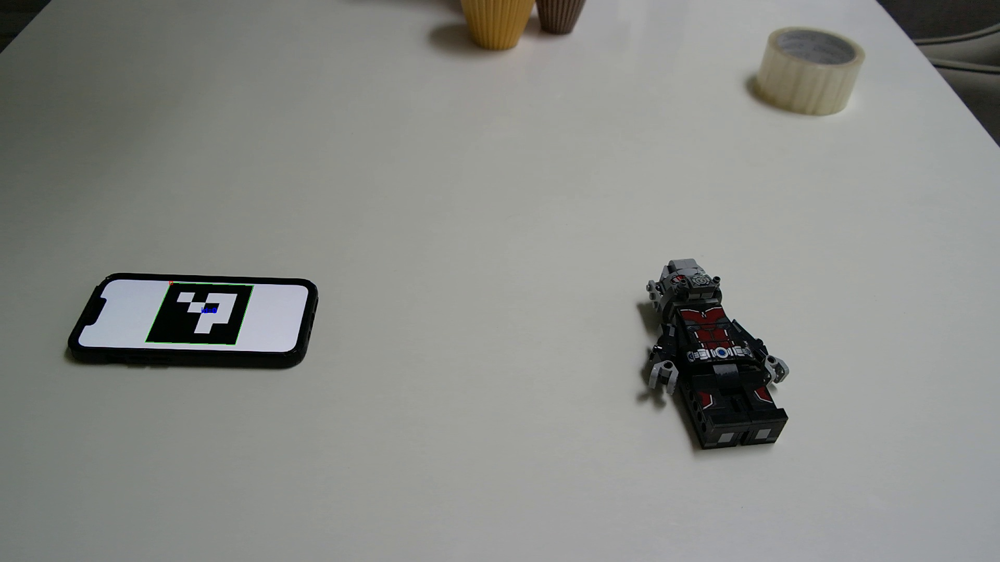
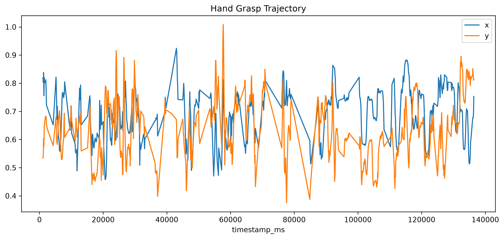
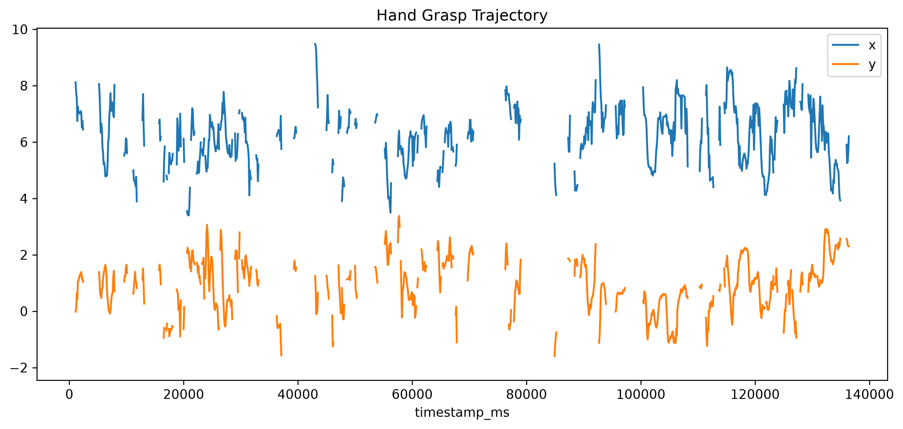
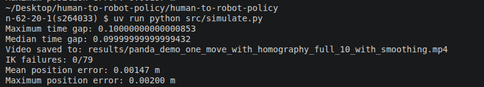

# Human to robot policy 

The goal of this project wwas to translate human hand motion into manipulator motion using a simple egocentric setup that can be captured from home. 

## Setup
The experiment was conducted at home using a Samsung camera with a 18-55 mm OIS zoom lens set to 18 mm throughout recording, recoding at 50 fps. 

The experiment involved moving around an object in the workspace, with an ArUco marker placed nearby with an ID=0 for later homography.

Human manipulation demonstrations were personally recorded using a stationary camera positioned to approximate an egocentric, over-the-shoulder perspective. The fixed viewpoint simplified trajectory extraction while preserving a first-person-like view of hand-object interaction.

To get all the necessary imports, uv sync is enough after cloning the repository. 

## Video processing

The full video was placed outside the cloned repository, but is provided in the repository here. To run the extract_frames script in src, it is recommended that the video is downloaded and saved accordingly or that the "video_path" is modified accordingly. 

Instead of picking every frame from the video for analysis and increasing computational load, every 5th frame was selected, extracting 10 frames per second. 

The frames were saved in folder frames/raw within the human-to-robot-policy repository, but were not tracked by git. The frame number corresponded to the original 50 fps video, e.g. frame 5 from the original video was still named frame 5 despite being frame 1 in the 10 fps extraction process. 

## ArUco detection

After extracting the frames, the goal was to detect the ArUco marker. Since the marker's dictionary had to be confirmed, every dictionary present in cv2 was attempted and the id was checked to see if a valid id was generated. This was done in the detect_dictionary_used script within the src. 

<em>DICT_4X4_50 image</em>


<em>DICT_4X4_100 image</em>

Both DICT 4X4 50 and 100 generated the correct id with proper corner detection, thus 50 was chosen due to its smaller dictionary size.

Then, using this dictionary, the detect_marker script checked for a matching ArUco marker in every frame captured. The marker was detected in 1312/1393 frames with a 94.2% detection rate. The frames where a marker was detected were saved in a csv file with the corner positions and frame number. 

## Track hand 

Hand tracking is handled using MediaPipe's Hand landmarker's model bundle which has both a palm detection model and a hand landmarks detection model build using Convolutional Neural Networks (CNNs) (source: https://developers.google.com/edge/mediapipe/solutions/vision/hand_landmarker/index#models). 

The accuracy of the task was checked in track_hand.py by checking if it could produce sucessful hand landmarks within the all detected frames [could it detect a wrong hand?], with the resulting accuracy being 53.6% accuracy. 6 images were also taken across the dataset to see if the wrist, index and thumb were all being detected correctly through visual inspection. 

Running mode of Video was used as the goal was to map out a hand trajectory. The track_hand_trajectory script found the TCP as the midpoint between the thumb and index finger. The motion within the dataset was a pick and place operation with some manipulation as well using primarily the thumb and index finger. 

<em>Hand trajectory generated</em>

In order to make sure that the motion scaled well with the video footage, a perspective homography was computed to express the detected hand positions in a tabletop-referenced coordinate system. As seen later, the resulting tranformed trajectories produced more pronounced movements. Since the hand moved above the marker, the resulting hand trajectories are approximate planar projections rather than accurate 3D reconstructions.


<em>Hand trajectory generated after homography</em>


## MuJoCo
MuJoCo was used to simulate the hand trajectories using a Franka-Eminka Panda manipulator. The mujoco Menagerie dependency was downloaded in a sibling directory. 

From parent:
```
git clone --depth 1 --filter=blob:none --sparse \
  https://github.com/google-deepmind/mujoco_menagerie.git

cd mujoco_menagerie
git sparse-checkout set franka_emika_panda
```
Then:
```
cd ../human-to-robot-policy
uv sync
```
The MuJoCo directory contains two initial validation scripts:

- **mujoco_test.py** verifies that the Panda model loads successfully and inspects its joints, actuators, and bodies.

- **mujoco_kinematics_test.py** validates the inverse kinematics implementation by defining a target Cartesian end-effector position and iteratively updating the robot's joint configuration using damped least-squares Jacobian inverse kinematics.

The tests establish the foundation for retargeting the extracted human hand trajectories to the Panda manipulator.

## Mapping hand trajectories to the manipulator
Since we can see some discontinuties in the hand trajectory, segments of contiuous blocks were identified for testing. Interval 1 was from 100.4s to 108.2s with 79 frames, interval 2 from 114.9s to 121.7s with 69 frames and interval 3 from 129.3 to 134.9s with 57 seconds. After extracting the trajectories, it could be seen that the motion of manipulator was still jittery due to noise. Thus, smoothing was added using a Savitzky-Golay filter, a second-order polynomial smoothing filter, to preserve the shape of the movements while preserving any high-frequency tracking noise. 

[(Without smoothing)](results/100.4s_to_108.2s/panda_demo_one_move_with_homography_full_10.mp4)

[(With smoothing)](results/100.4s_to_108.2s/panda_demo_one_move_with_homography_full_10_with_smoothing.mp4)

## Results

Interval 1: 
[(Watch demo)](results/100.4s_to_108.2s/panda_demo_one_move_with_homography_full_10_with_smoothing.mp4)
[(Watch correspond real demo)](results/100.4s_to_108.2s/Screencast%20from%202026-10-14%2021-12-17.mp4)





Interval 2: 
[(Watch demo)](results/114.9_to_121.7s/panda_demo_one_move_with_homography_with_smoothing_interval_2.mp4)
[(Watch correspond real demo)](results/114.9_to_121.7s/Screencast%20from%202026-10-16%2018-09-09.mp4)


Interval 3:
[(Watch demo)](results/129.3s_to_134.9s/panda_demo_one_move_with_homography_with_smoothing_interval_3.mp4)
[(Watch correspond real demo)](results/129.3s_to_134.9s/Screencast%20from%202026-10-16%2018-16-02.mp4)


The results show 0 Inverse Kinematics (IK) errors across the intervals, meaning the solver could compute a complete trajectory across the calculated waypoints with a  mean positional error within the inverse kinematic solution is also around 1.4 mm for all 3 tests, and maximum position error of around 2 mm. 

Upon visual inspection, it can be seen that the demos match their corresponding real demo's movement. The camera's orientation in mujoco places the manipulator on the left side while the video has the hand on the right side, which has to be noted when making comparisons between the videos. An overhead view was also used as only x and y are used from the grasp trajectory, while z is simulated using a sin wave. 

Improvements in tracking could be made with a model with better hand recognition. Also keeping the index and thumb implementation could have led to using simulate the gripper opening and closing using the movements of the thumb and index finger. 